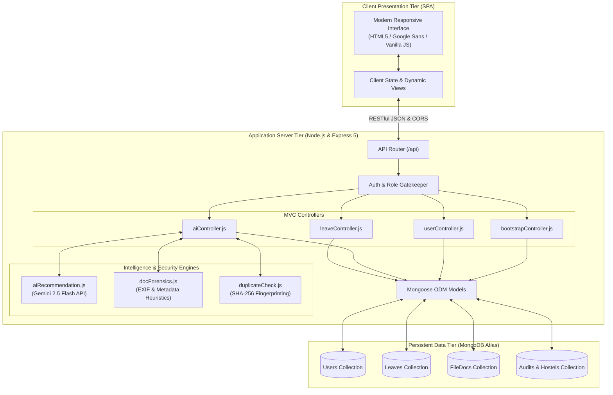

# Campus Catalyst - Digital Leave Management System (DLMS)

<div align="center">

[](https://nodejs.org/)
[](https://expressjs.com/)
[](https://www.mongodb.com/atlas)
[](https://ai.google.dev/)
[](https://www.docker.com/)
[](https://render.com/)
[](LICENSE)

<p align="center">
  <b>An enterprise-grade, full-stack campus governance platform engineered with sequential multi-tier approval workflows, AI-driven academic decision intelligence, cryptographic document fraud forensics, and real-time security gate dispatch.</b>
</p>

[Executive Summary](#executive-summary) • [Core Capabilities](#core-capabilities) • [System Architecture](#system-architecture) • [Role Matrix](#role-based-access-control-rbac) • [AI & Forensics](#ai-intelligence--fraud-prevention) • [API Reference](#api-reference) • [Deployment](#production-deployment)

---
</div>

## Executive Summary

Traditional institutional leave processing relies on disconnected paper forms, fragile physical signatures, and scattered messaging threads. These legacy methods lack accountability, slow down urgent student movements, and expose administrations to forged medical slips, recycled permissions, and attendance discrepancies.

**Campus Catalyst DLMS** modernizes campus mobility and accountability into a unified, transparent digital ecosystem. Built on a resilient **MERN / MVC** backbone, it enforces strict sequential authority pipelines, equips educators and wardens with **Google Gemini-powered decision intelligence**, performs **cryptographic document verification** to stop forged or duplicate certificates, and provides **Gate Security** with sub-second outpass verification.

---

## Core Capabilities

- **Strict Sequential Multi-Tier Approval Pipeline**: Requests flow deterministically through authority hierarchies (Class Teacher -> Warden -> HOD -> Joint Director -> Director) based on duration and student residency. Higher authorities are presented with requests only after prior required verifications pass.
- **Gemini-Powered Academic Decision Intelligence**: Evaluates student attendance records, previous semester CGPA/percentages, request frequency, and reason context (hackathons, medical emergencies, SSB interviews) to generate objective risk assessments (`APPROVE`, `APPROVE_WITH_CAUTION`, `NEEDS_REVIEW`).
- **Cryptographic Anti-Fraud & Document Forensics**:
  - **Cross-Student Reuse Detection**: Uses SHA-256 document hashing to instantly identify identical proof files uploaded by different students.
  - **Synthetic & AI Artifact Inspection**: Heuristic and multi-modal analysis checks uploaded proof images for metadata anomalies, missing EXIF structures, and synthetic image model signatures (Midjourney, Stable Diffusion).
- **Zero-Trust Role-Gated Visibility**: Forensic audits, fraud indicators, and AI recommendations are strictly isolated to authenticated administrative and faculty roles—never exposed to student-facing clients.
- **Sub-Second Gate Security Dispatch**: Integrated barcode/registration lookup grants campus security immediate verification of active, approved leaves and outpasses with complete audit accountability.
- **Immutable Audit Trail**: Every status transition, note, approval, and rejection is permanently timestamped and attributed with actor identifiers.
- **Cloud-Native & Production Ready**: Fully configured for containerized deployments with automated database seeders, DNS failover resolvers, health check probes (`/health`), and graceful shutdown routines.

---

## System Architecture

Campus Catalyst DLMS adheres to the **Model-View-Controller (MVC)** architectural paradigm, separating data models, client presentation, and business logic into modular, testable tiers.



---

## Repository Structure

```
DLMS/
├── config/
│   └── db.js                 # Resilient MongoDB Atlas connector with custom DNS fallbacks
├── controllers/
│   ├── aiController.js       # Staff-only AI analysis and forensics orchestrator
│   ├── authController.js     # User authentication and session verification
│   ├── bootstrapController.js# Initial state bootstrap & Gate pass verification
│   ├── departmentController.js# Academic department management
│   ├── fileController.js     # Base64 document storage & retrieval
│   ├── hostelController.js   # Hostel residence management
│   ├── leaveController.js    # Multi-stage leave lifecycle & approval pipeline
│   └── userController.js     # User provisioning & profile management
├── middleware/
│   ├── errorHandler.js       # Centralized HTTP status and exception handler
│   └── logger.js             # Formatted request/response logging middleware
├── models/
│   ├── Audit.js              # System action audit log schema
│   ├── Department.js         # Academic branch schema
│   ├── FileDoc.js            # Cryptographic hash and document storage schema
│   ├── Hostel.js             # Hostel residence schema
│   ├── Leave.js              # Comprehensive leave request & approval stages schema
│   └── User.js               # Multi-role user identity schema
├── routes/
│   ├── aiRoutes.js           # Endpoints for AI document review & recommendation
│   ├── authRoutes.js         # Authentication endpoints
│   ├── departmentRoutes.js   # Department configuration routes
│   ├── fileRoutes.js         # Secure document upload/download routes
│   ├── hostelRoutes.js       # Hostel routes
│   ├── index.js              # Master API router mounting all sub-routes
│   ├── leaveRoutes.js        # Leave application, review, and status routes
│   └── userRoutes.js         # User administration routes
├── utils/
│   ├── aiRecommendation.js   # Gemini 2.5 Flash rule-based + LLM scoring engine
│   ├── docForensics.js        # Offline EXIF/AI image generation heuristic checks
│   ├── duplicateCheck.js     # Cross-student SHA-256 hash collision detector
│   ├── helpers.js            # Formatting, date computations, and validators
│   ├── migrate-to-atlas.js   # Database migration and cloud sync utility
│   └── seeder.js             # Automated seed generator for roles & master data
├── Dockerfile                # Production multi-stage Docker container configuration
├── Procfile                  # Process manager config for cloud hosts
├── render.yaml               # Infrastructure-as-Code blueprint for Render
├── server.js                 # Application entry point & graceful shutdown handler
├── start.js                  # Deployment entry-point alias
├── index.html                # High-performance SPA frontend view
├── styles.css                # Polished design system with dark/light tokens
└── app.js                    # Reactive client application logic & state machine
```

---

## Role-Based Access Control (RBAC)

The system governs permissions using an 8-level Role-Based Access Control matrix:

| Role | Target Scope | Responsibilities & Permissions |
| :--- | :--- | :--- |
| **`STUDENT`** | Self | Submit leave applications, upload proof documents, track real-time approval stages, generate digital outpass. |
| **`CLASS_TEACHER`** | Section / Dept | Stage 1 review; checks academic standing, class attendance, and verifies parent communication. |
| **`WARDEN`** | Hostel Block | Hostel outpass validation; verifies room records, curfew compliance, and hostel attendance. |
| **`HOD`** | Department | Stage 2/3 academic approval for multi-day leaves, industrial visits, or competitive hackathons. |
| **`JD`** | Institution | Joint Director authorization for extended absences, interstate travel, or special leaves. |
| **`DIRECTOR`** | Institution | Final administrative escalation for exceptional leaves and policy dispensations. |
| **`GATE`** | Campus Entry | Quick-scan verification of student registration number, departure authorization, and outpass validity. |
| **`ADMIN`** | System-Wide | User management, authority credential provisioning, department/hostel configuration, and audit reviews. |

---

## AI Intelligence & Fraud Prevention

### 1. Dual-Tier Document Authenticity Forensics
Uploaded proof documents (medical certificates, event invitations, parent sanction letters) undergo two-tiered screening:
- **Heuristic Metadata Analysis**: Detects signature markers left by generative AI platforms (Stable Diffusion, Midjourney, DALL-E) and flags synthetic generation indicators or missing camera EXIF profiles.
- **Multimodal LLM Verification**: When configured with `GEMINI_API_KEY`, files can optionally be verified against Gemini 2.5 Flash Vision to inspect typography and digital doctor seal consistency.

### 2. Cryptographic Cross-Student Reuse Detection
A common campus fraud vector involves multiple students submitting the exact same hospital discharge slip or event pass with altered names:
- Every uploaded document is converted to its cryptographic **SHA-256 content digest**.
- The `duplicateCheck.js` module performs cross-student database scans for matching file hashes across historical and concurrent requests, instantly alerting staff to reused documents.

### 3. Holistic Risk & Academic Scoring
The AI evaluation combines deterministic criteria with LLM reasoning:
$$\text{Risk Score} = f(\text{Attendance } \%, \text{ CGPA / Last Sem } \%, \text{ Duration Days}, \text{ Frequency}, \text{ Duplicate Flags})$$
- Generates categorized recommendations: `APPROVE`, `APPROVE_WITH_CAUTION`, or `NEEDS_REVIEW`.
- Provides concise bullet-point justifications explaining why an absence is educationally sound or requires parental follow-up.

---

## API Reference

### Health & Gate Verification
| Method | Endpoint | Description |
| :--- | :--- | :--- |
| `GET` | `/health` | Cloud deployment health check probe (returns 200 OK with timestamp) |
| `GET` | `/api/bootstrap` | Bootstraps initial application state, active sessions, and master records |
| `GET` | `/api/gate/check/:reg` | Instant gate verification lookup for active leaves by registration number |

### Authentication (`/api/auth`)
| Method | Endpoint | Description |
| :--- | :--- | :--- |
| `POST` | `/api/auth/login` | Authenticate user credentials and return user profile and scope |
| `POST` | `/api/auth/change-password` | Update account password and clear mandatory change flags |

### Leave Management (`/api/leaves`)
| Method | Endpoint | Description |
| :--- | :--- | :--- |
| `GET` | `/api/leaves` | Retrieve leave requests scoped by user role and authority level |
| `POST` | `/api/leaves` | Submit a new student leave application |
| `GET` | `/api/leaves/:id` | Fetch detailed leave record with attached document identifiers |
| `POST` | `/api/leaves/:id/decision` | Submit stage approval or rejection with mandatory reviewer notes |
| `POST` | `/api/leaves/:id/cancel` | Cancel an active or pending leave application (Student only) |

### AI Review & Decision Support (`/api/ai`)
| Method | Endpoint | Description |
| :--- | :--- | :--- |
| `POST` | `/api/ai/leaves/:id/analyze` | Run/refresh AI recommendation and document forensic inspection |
| `GET` | `/api/ai/leaves/:id/review` | Retrieve cached AI evaluation (Strictly restricted to staff roles) |

---

## Getting Started & Local Development

### Prerequisites
- **Node.js**: `v18.0.0` or higher
- **npm**: `v9.0.0` or higher
- **MongoDB**: Local MongoDB instance (`mongodb://127.0.0.1:27017/dlms`) or a free [MongoDB Atlas](https://www.mongodb.com/atlas) cluster

### Installation

1. **Clone the Repository**:
   ```bash
   git clone https://github.com/Janmejay250171/CAMPUS-CATALYST-PROJECT.git
   cd CAMPUS-CATALYST-PROJECT/DLMS
   ```

2. **Install Dependencies**:
   ```bash
   npm install
   ```

3. **Configure Environment Variables**:
   Create a `.env` file in the root directory (refer to `.env.example`):
   ```env
   PORT=5000
   NODE_ENV=development
   MONGODB_URI=mongodb://127.0.0.1:27017/dlms
   DATABASE_NAME=dlms
   AI_MODEL=gemini-2.5-flash
   GEMINI_API_KEY=your_optional_gemini_api_key_here
   ```

4. **Start the Application**:
   ```bash
   npm start
   ```
   The server will initialize, automatically connect to MongoDB, seed default authority and demo accounts, and serve the application on:
   ```
   http://localhost:5000
   ```

### Windows Quick-Run Scripts
- **`start-mern.bat`**: One-click script that launches the Node server and opens your default browser at `http://localhost:5000`.
- **`open-app.bat`**: Directly launches the web application frontend in your default browser.

---

## Production Deployment

### Option A: Render Cloud Deployment (Recommended)
This repository includes a native [`render.yaml`](render.yaml) specification:
1. Fork or push this repository to your GitHub account.
2. Sign in to [Render](https://render.com) and click **New > Blueprint**.
3. Select your repository `Janmejay250171/CAMPUS-CATALYST-PROJECT`.
4. Render will parse `render.yaml`, set build/start commands, configure the `/health` check path, and prompt for secret environment variables (`MONGODB_URI`, `GEMINI_API_KEY`).
5. Click **Apply** to trigger automatic provisioning and continuous deployment on every `git push`.

### Option B: Docker Containerization
Build and run the application in an isolated, production-grade container:

1. **Build the Docker Image**:
   ```bash
   docker build -t campus-catalyst-dlms .
   ```

2. **Run the Container**:
   ```bash
   docker run -d \
     -p 5000:5000 \
     -e PORT=5000 \
     -e NODE_ENV=production \
     -e MONGODB_URI="your_mongodb_atlas_uri" \
     -e DATABASE_NAME="dlms" \
     --name dlms-app \
     campus-catalyst-dlms
   ```

3. **Verify Container Health**:
   ```bash
   curl http://localhost:5000/health
   ```

---

## Environment Variables

| Variable | Description | Default / Example | Required |
| :--- | :--- | :--- | :---: |
| `PORT` | Network port the HTTP server binds to | `5000` | Optional |
| `NODE_ENV` | Runtime environment (`development` / `production`) | `development` | Optional |
| `MONGODB_URI` | MongoDB connection string (Atlas SRV or Local URI) | `mongodb://127.0.0.1:27017/dlms` | **Yes** |
| `DATABASE_NAME` | Target MongoDB database name | `sehatsure` or `dlms` | Optional |
| `GEMINI_API_KEY` | Google Gemini API key for advanced AI review | *None (uses offline heuristics)* | Optional |
| `AI_MODEL` | Gemini model version identifier | `gemini-2.5-flash` | Optional |

---

## Security & Privacy Practices

- **Role-Based Isolation**: Staff-only AI reviews and cryptographic fraud evaluations are gated both at the Express controller level and in client-side state mapping.
- **Fail-Safe Fallbacks**: If the cloud Gemini API is unreachable or `GEMINI_API_KEY` is not provided, the platform automatically falls back to deterministic rule scoring and local document heuristics without service interruption.
- **Graceful Shutdown**: Handles `SIGTERM` and `SIGINT` signals to flush pending requests, release database connections, and terminate cleanly in container orchestrators.
- **Input Sanitization**: Request payloads and base64 uploads are limited (`16MB`) and sanitized to prevent memory exhaustion and injection attacks.

---

## License & Maintainer

Distributed under the **ISC License**. Developed and maintained by **[Janmejay Singh](https://github.com/Janmejay250171)**.

<div align="center">
  <sub>Campus Catalyst DLMS · Transforming Campus Mobility with Integrity & Intelligence</sub>
</div>
